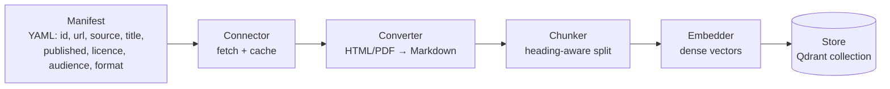
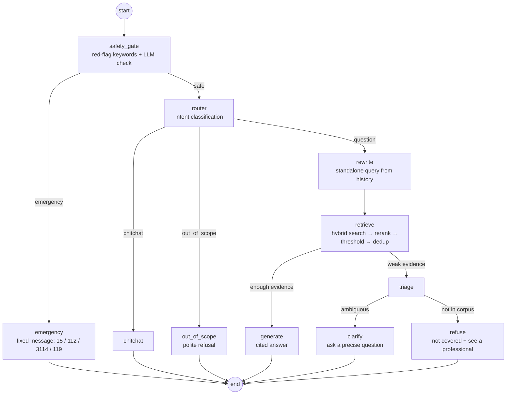

# Architecture

Three parts, one direction of data flow:

```
            write side                                   read side
┌──────────────────────────────┐            ┌───────────────────────────────────┐
│ Ingestion (CLI, batch)        │            │ Backend (FastAPI + LangGraph)      │
│ manifest → … → vector store   │ ─────────▶ │ question → graph → streamed answer │
└──────────────────────────────┘   index     └───────────────────────────────────┘
                                                            │ SSE
                                                            ▼
                                             ┌───────────────────────────────────┐
                                             │ Frontend (React chat, sources)     │
                                             └───────────────────────────────────┘
```

The backend never writes to the index; ingestion never serves users.

## 1. Ingestion pipeline

Data funnel: a few dozen curated sources become a few thousand clean, cited chunks.



| Step | Interface (`core/`) | Input → Output | Default implementation |
|---|---|---|---|
| Connector | `Connector` | manifest entry → raw bytes on disk (cached) | `HttpConnector` (httpx, robots.txt, per-host delay) |
| Converter | `Converter` | raw file → `ConvertedDocument` (Markdown + metadata) | `HtmlConverter` (trafilatura), `PdfConverter` (docling), routed by `format` |
| Chunker | `Chunker` | `ConvertedDocument` → `list[Chunk]` | `MarkdownChunker` (header split, then recursive split) |
| Embedder | `Embedder` | `embed_documents(list[str])` and `embed_query(str)` → dense vectors. They are separate because some models need different query and passage prefixes. | `SentenceTransformerEmbedder` (local GPU); `OpenAICompatibleEmbedder` (remote endpoint) |
| Store | `VectorStore` | `list[Chunk]` + vectors → upserted ids; query → scored chunks | `QdrantStore` (local mode). It computes the BM25 sparse vectors itself with fastembed and fuses dense and sparse results with RRF. |

### Design rules

- **Strategy pattern.** Each step is an abstract class in `core/`. Swapping a source, an
  embedding model or a vector database means instantiating a different class in the
  pipeline factory. Nothing else changes. This is how the GP profile and the production
  deployment reuse the same code.
- **Template method.** `Pipeline.run()` owns the sequence and the error handling:
  fetch → convert → chunk → embed → upsert, one document at a time.
- **Per-document fault isolation.** A document that fails to fetch or convert is logged and
  skipped; the run continues.
- **Idempotent re-ingestion.** Before upserting a document, the store deletes the existing
  points whose `doc_id` matches. Point ids are `uuid5(doc_id#chunk_index)`, since Qdrant
  requires UUIDs or integers. Re-running ingestion, even after a page has changed, never
  leaves stale or duplicate chunks.
- **Metadata stays out of the embedded text.** Source, URL, date and heading path live in
  the payload. The embedded text is the chunk content, optionally prefixed with its heading
  path (headings carry meaning; URLs and dates do not).
- **Corpus snapshot committed, index rebuilt.** Fetched pages (`data/raw/`) and converted
  Markdown (`data/markdown/`) are committed so the demo runs offline or in a Codespace.
  The vector index (`data/qdrant/`) is gitignored and rebuilt from the snapshot (see
  [sources.md](sources.md#licensing-strategy)).

### Chunk payload

```json
{
  "doc_id": "ameli-traitement",
  "chunk_index": 3,
  "text": "…",
  "heading_path": ["Traitement de l'endométriose", "Traitements hormonaux"],
  "source": "Ameli",
  "title": "Traitement de l'endométriose",
  "url": "https://www.ameli.fr/…",
  "published": "2026-04-09",
  "retrieved": "2026-11-21",
  "audience": "patient",
  "licence": "all-rights-reserved",
  "format": "html | pdf | video",
  "start_seconds": null
}
```

`doc_id` is the manifest `id`. The golden set references documents by this id.
`start_seconds` is only used by the optional video connector
(see [sources.md](sources.md#optional-videos-with-french-captions)).

## 2. Conversation graph (LangGraph)



### Nodes

| Node | Role | Uses LLM | Output |
|---|---|---|---|
| `safety_gate` | Detects emergencies **before anything else**, on the latest user message. A deterministic French keyword and pattern list runs first. It covers sudden severe pain, fainting, heavy bleeding, high fever with pelvic pain, pain with a possible pregnancy or late period (ectopic pregnancy), sudden one-sided pain (torsion, ruptured cyst) and suicidal thoughts. A small, fast model then double-checks the message. Either can trigger. If the model call fails or times out, the keyword result stands and the answer carries the emergency footer. | Small model | `emergency: bool`, `kind: medical | psychological` |
| `emergency` | Returns the fixed, pre-written message from [scope.md](scope.md#fixed-emergency-message-draft-to-be-reviewed-by-a-health-professional). It is never generated, so it cannot be wrong or slow. | No | Fixed text |
| `router` | Classifies intent: `chitchat`, `out_of_scope`, `question`. Also flags `asks_for_diagnosis` (explicit or implicit, e.g. "c'est normal ?", "mes symptômes correspondent ?") and `asks_for_prescription`, so `generate` applies the right wording. Any health content routes to `question`, even when mixed with a greeting. | Small model, JSON mode | `RouteDecision` |
| `chitchat` | Greetings and thanks, plus a short presentation of what the assistant can do. It is a template, so no ungrounded medical text can come out of it. | No (template) | Text |
| `out_of_scope` | Polite refusal that restates the assistant's scope. | No (template) | Text |
| `rewrite` | Turns a follow-up ("et pendant la grossesse ?") into a standalone query using the last turns. In v1 it only resolves conversation context. Lay vocabulary is handled by dense retrieval, and lay-to-clinical expansion is on the backlog. | Small model | Query string |
| `retrieve` | Hybrid search (dense + BM25, RRF fusion) for top-k candidates, a cross-encoder rerank, a relevance threshold, then near-duplicate removal. | No | Ranked chunks with scores |
| `generate` | Emits the chunks it was given as sources, then answers **only** from them, in French, with numbered citations `[1]`, `[2]`. If the router flagged a diagnosis or prescription request, it gives general information, never concludes "vous avez / vous n'avez pas", and explicitly refers the user to a health professional. | Main model (Nemotron 3 Ultra) | Streamed text |
| `triage` | Runs when evidence is weak (no chunk above threshold, or too few). Decides between *ambiguous question* and *not in the corpus*. | Small model | `clarify | refuse` |
| `clarify` | Asks one precise follow-up question. | Main model | Text |
| `refuse` | States the information is not in the sources, then refers the user to a professional and to reliable sites. | No (template) | Text |

**Right-sized models.** Classification nodes can use a smaller, faster model
(`LLM_SMALL_MODEL`, for example Nemotron 3 Super; availability to verify). Only
`generate` and `clarify` need the 550B model. This cuts latency and cost without changing
quality where it matters.

### Why emergency comes first

An emergency message must never depend on retrieval quality or on the main model's
behaviour. The gate runs before routing, and the emergency answer is a constant. A
deterministic keyword list guarantees that the known regression cases trigger every
time. The LLM check catches the phrasings the list misses. The keyword list is
illustrative and must be validated by a medical professional before any real use.

### State

```python
class GraphState(TypedDict):
    messages: Annotated[list[AnyMessage], add_messages]
    emergency: EmergencyDecision | None
    route: RouteDecision | None
    query: str | None
    chunks: list[ScoredChunk]
    triage: Literal["clarify", "refuse"] | None
```

### Streaming contract (backend → frontend)

`POST /api/chat` returns `text/event-stream` in the
[AI SDK UI message stream](https://ai-sdk.dev/docs/ai-sdk-ui/stream-protocol) format, so the
React side uses an off-the-shelf chat runtime:

| Event part | Emitted by | Content |
|---|---|---|
| `data-route` | `safety_gate`, `router` | Route taken (`emergency`, `question`…) for the UI badge and for tracing |
| `source-url` / `source-document` | `generate` | One per chunk passed to generation: id, title, URL, organisation, date. They are never sent on refuse or clarify answers. |
| `text-start` / `text-delta` / `text-end` | answering nodes | Answer tokens |
| `finish`, then `[DONE]` | API | End of message |

Request body, as sent by the AI SDK transport:
`{"id": "...", "messages": [{"id": "...", "role": "user", "parts": [{"type": "text", "text": "..."}]}]}`.
The last N turns are converted to LangChain `HumanMessage` / `AIMessage`. The response sets
the header `x-vercel-ai-ui-message-stream: v1`.

The graph is streamed with `graph.astream(stream_mode=["messages", "custom"])`. Nodes push
routes and sources with `get_stream_writer()`. Token chunks are filtered by
`langgraph_node`, so the router's JSON never leaks into the answer.

### Prompts

One Markdown file per node in `back/prompts/<profile>/<node>.md`, loaded by name. Prompts are
written in French because they shape the French output; everything else in the repo is in
English.

## Profiles

A **profile** bundles what changes between use cases:

| Profile item | Patient profile | GP profile |
|---|---|---|
| Manifest | `ingestion/manifests/patient.yaml` | `ingestion/manifests/gp.yaml` |
| Qdrant collection | `patient__<embedder>` | `gp__<embedder>` |
| Prompts | `back/prompts/patient/` (plain language, empathetic) | `back/prompts/gp/` (clinical register, red flags, referral criteria) |
| Refusal and emergency wording | Patient-facing | Practitioner-facing |

The profile is selected by configuration (`PROFILE=patient`). The code is identical.
The collection name includes the embedder id, so changing models never mixes vector spaces.

## Backend design patterns

The backend follows the same principles as ingestion: interfaces in `back/src/core/`,
implementations next to them, wiring in one place.

| Pattern | Where | What it buys |
|---|---|---|
| **Strategy** | `Retriever` (hybrid Qdrant), `Reranker` (cross-encoder, none), `ChatModelProvider` (any OpenAI-compatible endpoint), `SafetyCheck` (keyword, LLM) | Swap Qdrant for Azure AI Search, or the local reranker for Cohere, by instantiating another class. The graph code does not change. |
| **Composite** | `CompositeSafetyCheck([KeywordSafetyCheck(), LlmSafetyCheck()])` | Each check stays small and testable. The gate triggers if any check triggers, and a failing check never disables the others. |
| **Template method** | `BaseNode.__call__(state)` runs `_prepare(state)`, then `_execute(...)`, then `_to_update(...)`, with shared logging, timing and error handling. Template answers (`emergency`, `chitchat`, `out_of_scope`, `refuse`) subclass `TemplateNode`, which only declares the prompt file. | Every node behaves the same way on errors and in traces. Adding a node means filling in one or two methods. |
| **Factory** | `back/src/graph/builder.py` builds the graph from `Settings` and the active profile | One place decides which strategies are used |

All data crossing a boundary is a **Pydantic model**: manifest entries, converted documents,
chunks, scored chunks, route and safety decisions, API requests and stream events. Raw
dicts are not passed between modules.

## Repository layout

Three top-level parts, matching the three layers. All Python runs in one conda env.
Each Python part is installed in editable mode with `uv pip install -e`.

```
endometriosis-rag/
├── ingestion/                    # write side
│   ├── pyproject.toml            # package: endorag_ingestion
│   ├── manifests/                # patient.yaml, gp.yaml (URLs + metadata only)
│   ├── src/endorag_ingestion/
│   │   ├── settings.py           # paths and config (see below)
│   │   ├── core/                 # interfaces + Pydantic models: Connector, Converter, Chunker,
│   │   │                         # Embedder, VectorStore, ManifestEntry, ConvertedDocument, Chunk
│   │   ├── connectors/           # http.py
│   │   ├── converters/           # html.py (trafilatura), pdf.py (docling), routing.py
│   │   ├── chunkers/             # markdown.py
│   │   ├── embedders/            # sentence_transformers.py, openai_compatible.py
│   │   ├── stores/               # qdrant.py (dense + BM25, RRF)
│   │   ├── pipeline.py           # template method: fetch → convert → chunk → embed → upsert
│   │   └── cli.py                # `endorag-ingest --profile patient`
│   └── tests/
├── back/                         # read side
│   ├── pyproject.toml            # package: endorag_back (depends on endorag_ingestion)
│   ├── prompts/{patient,gp}/     # one .md per node
│   ├── src/endorag_back/
│   │   ├── settings.py
│   │   ├── core/                 # interfaces + Pydantic models: Retriever, Reranker, SafetyCheck,
│   │   │                         # ChatModelProvider, BaseNode, RouteDecision, SafetyDecision, ScoredChunk
│   │   ├── retrieval/            # qdrant_retriever.py, cross_encoder.py
│   │   ├── safety/               # keywords.py, llm_check.py, composite.py
│   │   ├── graph/                # state.py, nodes/, builder.py
│   │   └── api/                  # app.py, routes/chat.py (SSE), routes/health.py, stream.py
│   └── tests/                    # tier 1: safety, routing, nodes (offline)
├── front/                        # Vite + React + TypeScript + assistant-ui (French UI)
├── eval/                         # golden sets, embedding benchmark, RAGAS runner, reports/
├── data/                         # raw/ and markdown/ committed; qdrant/ gitignored
├── docs/
├── environment.yml               # conda env (python 3.12); packages installed with uv pip
└── .env.example
```

The back reuses the ingestion package's embedders, store and models, instead of copying them
or manipulating `PYTHONPATH`. The vector space and payload schema are defined once, on the
write side.

### Settings and paths

Each Python part has a `settings.py` with a `pydantic-settings` `Settings` class and
module-level path constants derived from the repo root. Nothing hard-codes a path elsewhere.

```python
# ingestion/src/endorag_ingestion/settings.py
ROOT_DIR = Path(__file__).resolve().parents[3]
DATA_DIR = ROOT_DIR / "data"
RAW_DIR = DATA_DIR / "raw"            # fetched HTML/PDF cache
MARKDOWN_DIR = DATA_DIR / "markdown"  # converted documents
QDRANT_DIR = DATA_DIR / "qdrant"      # local vector database
MANIFESTS_DIR = ROOT_DIR / "ingestion" / "manifests"

class Settings(BaseSettings):
    model_config = SettingsConfigDict(env_file=ROOT_DIR / ".env", extra="ignore")
    profile: Literal["patient", "gp"] = "patient"
    embedder: str = "BAAI/bge-m3"
    qdrant_path: Path = QDRANT_DIR
    llm_base_url: str
    llm_api_key: SecretStr = Field(validation_alias=AliasChoices("LLM_API_KEY", "FREELLMAPI_API_KEY"))
```

Every value can be overridden from `.env`. Only `.env.example` is committed.
