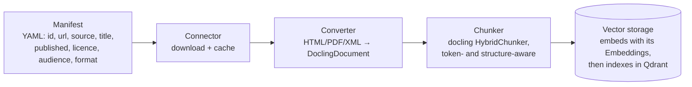

# Architecture

Three parts, one direction of data flow:

```
            write side                                   read side
┌──────────────────────────────┐            ┌───────────────────────────────────┐
│ Ingestion (CLI, batch)        │            │ Backend (FastAPI + LangGraph)      │
│ manifest → … → vector store   │ ─────────▶ │ question → graph → streamed answer │
└──────────────────────────────┘   index     └───────────────────────────────────┘
                                                            │ SSE
                                                            ▼
                                             ┌───────────────────────────────────┐
                                             │ Frontend (chat widget, sources)    │
                                             └───────────────────────────────────┘
```

The backend never writes to the index; ingestion never serves users.

## 1. Ingestion pipeline

Data funnel: a few dozen curated sources become a few thousand clean, cited chunks.



| Step | Base class (`core/`) | Input → Output | Default implementation |
|---|---|---|---|
| Connector | `BaseConnector` | `download(entry)`: manifest entry → `RawDocument`, raw bytes cached on disk by the base class | `HttpConnector` (httpx, robots.txt, per-host delay, retries) implements `_download_to()` |
| Converter | `BaseConverter` | `convert(raw)`: raw file → `ConvertedDocument` (docling `DoclingDocument` + Markdown snapshot + metadata), through `_parse` → `_repair` (on failure) → `_enrich` (cleaning) | `HtmlConverter` (trafilatura Markdown parsed by docling's Markdown backend; docling HTML backend as fallback), `PdfConverter` (docling, keeps page numbers), `JatsConverter` (docling JATS), routed by `format` by `RoutingConverter` and cached by `CachedConverter`, which wraps it (`CachedConverter(RoutingConverter())`). Tables of contents are removed by label (`DOCUMENT_INDEX`), and the dot-leader line filter on chunk text catches the rest; the back matter (from the first heading such as References, Sources, Participants, Remerciements, Acknowledgements or a final Contact block to the end) and annexes that are blank report forms (`[<>]` fields) are removed too; page headers and footers are docling furniture, left out of chunks. Web pages also lose share and rating widgets, glossary tooltips and their trailing related-links block (from a heading such as « Voir aussi », « En savoir plus » or « Les autres symptômes » to the end). |
| Chunker | none (single class) | `chunk(document)`: `ConvertedDocument` → `list[Chunk]` | `HybridChunker` (`chunker/hybrid.py`), the only chunker, so it has no base class: docling `HybridChunker` with the embedder's tokenizer (`nvidia/Nemotron-3-Embed-1B-BF16`), at most 512 tokens per chunk headings included, small neighbours under the same headings merged, tables serialized as Markdown tables. Chunk text is cleaned (bullet glyphs, dot leaders, entities, links, table padding) and near-empty chunks are dropped. |
| Embedder | none (single class); subclasses LangChain's `Embeddings` | `embed_documents(list[str])` and `embed_query(str)` → dense vectors. Not a pipeline step: injected into the vector storage. | `OpenAICompatibleEmbedder` (`embedder/openai_compatible.py`), the only embedder: `EMBEDDER` (default `nemotron-3-embed-1b`) through the OpenAI-compatible endpoint, batched, retried and cached on disk; exposes `dimension`. Built by `factory.build_storage` from the settings. Comparing embedding models means changing `EMBEDDER` to another model served by the same endpoint (e.g. `gemini-embedding-001`). LangChain's `Embeddings` interface is kept because it costs nothing and lets other LangChain-based tools (e.g. the RAGAS evaluation) reuse the same embedder. |
| Vector storage | `BaseVectorStore` | `add_documents(chunks)` → ids; `delete_by_metadata(field, value)` → count; `upsert_documents(chunks, key_field="doc_id")` (in the base class: delete per key value, then add); `search(query, k)` → scored chunks | `QdrantStore` (local mode). It **owns its `Embeddings`**, so documents and queries are always embedded by the same model and callers pass text, never vectors. It computes the BM25 sparse vectors itself with fastembed and fuses dense and sparse results with RRF. Each hit also carries its raw dense cosine similarity (`ScoredChunk.dense_score`): the RRF score is rank-based and cannot tell weak evidence apart. |

### Design rules

- **Strategy pattern, only where it pays.** A step gets a `Base*` class in `core/` (one
  per file: `base_connector.py`, `base_converter.py`, `base_vector_store.py`,
  `base_pipeline.py`) only where the project shows room for research or new deployments:
  new sources (connector), new formats (converter), another vector database in production
  (vector storage), another pipeline. The chunker (`HybridChunker`) and the embedder
  (`OpenAICompatibleEmbedder`) have a single implementation, so they are plain classes with
  no abstraction; changing the embedding model is a setting (`EMBEDDER`), not a new class.
  Swapping a source or a vector database means instantiating a different class in the
  composition root (`factory.py`). Nothing else changes. This is how the GP profile and
  the production deployment reuse the same code.
- **Template method.** `BasePipeline.run()` owns the sequence and the error handling:
  `_download` → `_convert` → `_chunk` → `_store` (`storage.upsert_documents`, which embeds),
  one document at a time. `BaseConverter.convert()` does the same for a conversion:
  `_parse` (format-specific), `_repair` (optional retry on failure), `_enrich` (a no-op in
  the base; `CleaningConverter`, the base of the format converters, cleans there).
  `RoutingConverter` only routes and keeps that template: its `_parse` and `_repair` go to
  the converter of `entry.format`, and its `_parse` also runs that converter's `_enrich`
  (which receives no entry to route on).
  `close()` releases the connector, the converter and the storage.
- **Decorator.** `CachedConverter` wraps any converter and owns the conversion cache
  (`data/markdown/<id>.md`, `.docling.json`, `.meta.json` with the raw file's sha256 and
  `CONVERTER_VERSION`); the wrapped converter runs only on a cache miss.
- **Per-document fault isolation.** A document that fails to download or convert is logged and
  skipped; the run continues.
- **Idempotent re-ingestion.** `upsert_documents` deletes the existing points whose
  `doc_id` matches (`delete_by_metadata`) before adding the new ones. Point ids are `uuid5(doc_id#chunk_index)`, since Qdrant
  requires UUIDs or integers. Re-running ingestion, even after a page has changed, never
  leaves stale or duplicate chunks.
- **Metadata stays out of the embedded text.** Source, URL, date and heading path live in
  the payload. The embedded text is the chunk content, optionally prefixed with its heading
  path (headings carry meaning; URLs and dates do not).
- **Corpus snapshot committed, index rebuilt.** Fetched pages (`data/raw/<id>.<ext>` +
  `.meta.json`) and converted documents (`data/markdown/<id>.docling.json`, the
  DoclingDocument that gets chunked, plus a readable `<id>.md` and a `.meta.json` recording the
  source hash and converter version) are committed so the demo runs offline or in a Codespace:
  a rebuild runs neither trafilatura nor docling. Chunking only needs the embedder's
  tokenizer (about 17 MB, downloaded once from Hugging Face).
  The vector index (`data/qdrant/`) is gitignored and rebuilt from the snapshot (see
  [sources.md](sources.md#licensing-strategy)).

### Chunk payload

```json
{
  "doc_id": "ameli-traitement",
  "chunk_index": 3,
  "text": "…",
  "heading_path": ["Traitement de l'endométriose", "Traitements hormonaux"],
  "source": "Ameli",
  "title": "Traitement de l'endométriose",
  "url": "https://www.ameli.fr/…",
  "published": "2026-04-09",
  "retrieved": "2026-11-21",
  "audience": "patient",
  "licence": "all-rights-reserved",
  "format": "html | pdf | xml | video",
  "page": null,
  "start_seconds": null
}
```

`doc_id` is the manifest `id`. The golden set references documents by this id.
`page` is the PDF page of the chunk's first item (`null` for HTML and XML); a PDF citation
links to `url#page=N` (`Chunk.citation_url`). The heading path comes from docling's chunk
headings, with the manifest title prepended when the document has no title of its own.
`start_seconds` is only used by the optional video connector
(see [sources.md](sources.md#optional-videos-with-french-captions)).

## Frontend: an embeddable chat widget

The frontend is built as a **widget**, not a full application: a floating chat bubble that
any host page can embed, plus a demo host page (the fictional campaign site).

```html
<!-- On the host site -->
<script src="https://<widget-host>/widget.js" data-api="https://<api-host>" data-profile="patient" defer></script>
```

| Concern | Choice |
|---|---|
| Embedding | One script tag mounts the React widget into a Shadow DOM, so the host page's CSS and the widget's CSS never interfere. An iframe build is the fallback for hosts with a strict Content Security Policy. |
| Configuration | `data-*` attributes: API URL, profile (`patient` or `gp`), initial open state, accent colour. |
| Behaviour | Bubble → panel with banner, disclaimer, streamed answers and source cards linking to the original pages. On a phone the panel goes full screen. |
| Backend contract | Unchanged: the widget calls `POST /api/chat` (AI SDK UI message stream). CORS allows the host origins listed in the backend settings. |
| Demo | `front/` builds both the widget bundle and a fictional campaign page that embeds it. |

## 2. Conversation graph (LangGraph)

```mermaid
flowchart TD
    START((start)) --> SG[safety_gate<br/>red-flag keywords + LLM check]
    SG -->|emergency| EM[emergency<br/>fixed message of the profile]
    SG -->|safe| RT[router<br/>intent classification]
    RT -->|chitchat| CC[chitchat]
    RT -->|out_of_scope| OOS[out_of_scope<br/>polite refusal]
    RT -->|question| RW[rewrite<br/>standalone query from history]
    RW --> RE[retrieve<br/>hybrid search → dedup → cap →<br/>(rerank) → evidence threshold]
    RE -->|enough evidence| GE[generate<br/>cited answer]
    RE -->|weak evidence| TR[triage]
    TR -->|ambiguous| CL[clarify<br/>ask a precise question]
    TR -->|not in corpus| RF[refuse<br/>not covered + see a professional]
    EM --> END((end))
    CC --> END
    OOS --> END
    GE --> END
    CL --> END
    RF --> END
```

### Nodes

| Node | Role | Uses LLM | Output |
|---|---|---|---|
| `safety_gate` | Detects emergencies **before anything else**, on the latest user message. A deterministic French pattern list (`KeywordSafetyCheck(profile)`) runs first: pain with an acute marker (sudden onset, severe or abrupt one-sided pain, vomiting, fever, inability to walk or breathe), fainting, heavy bleeding or hemorrhage, pain or bleeding with a first-person pregnancy cue (pregnant, late period, positive test, suspected ectopic pregnancy), torsion or ruptured cyst, suicidal thoughts, self-harm and overdose (direct and indirect), and first-person violence or abuse. Intensity words alone and missed periods alone do not trigger (D-21, D-22). For the `gp` profile only the first-person patterns (suicidal thoughts, self-harm, overdose, violence) apply, since guideline questions name red flags; GP medical emergencies are left to the LLM check. When it triggers, the gate stops there, with no model call. Otherwise a small model (`LlmSafetyCheck`, JSON mode, `SAFETY_TIMEOUT_S`) double-checks the message. Either can trigger. If the model call fails or times out, the check returns `source="llm-error"` instead of raising and the keyword result stands; the graph goes on to the router, and the chat service ends the answer, whatever its route, with the profile's fixed `safety_footer.md` naming 15 / 112 (no generated disclaimer is relied on: the GP disclaimer and `clarify` answers do not name them). | Small model (only when the keywords miss) | `SafetyDecision`: `emergency`, `kind` (`medical`, `psychological`, `minor` or none), `matched` pattern labels, `source` (`keyword`, `llm`, `llm-error`) |
| `emergency` | Template node: returns the fixed, pre-written message of the profile, `prompts/<profile>/emergency.md`, verbatim (the patient text is the draft in [scope.md](scope.md#fixed-emergency-message-draft-to-be-reviewed-by-a-health-professional); the GP text gives the same numbers in a practitioner register). It is never generated, so it cannot be wrong or slow. | No | Fixed text |
| `router` | Classifies intent: `chitchat`, `out_of_scope`, `question`. Also flags `asks_for_diagnosis` (explicit or implicit, e.g. "c'est normal ?", "mes symptômes correspondent ?") and `asks_for_prescription`, so `generate` applies the right wording. Any health content routes to `question`, even when mixed with a greeting. It sees the past turns, so a follow-up is a question; they are sent as one labelled transcript (`nodes/history.py: transcript`, « Historique : … Dernier message : … »), not as chat turns, because in JSON mode the gateway's model answered `{"": ""}` to 4 of 6 identical multi-turn calls (0 of 6 as a transcript). An unparsable reply or a failed call routes to `question` (retrieval and grounded generation are the safe path). | Small model, JSON mode | `RouteDecision`: `route`, `asks_for_diagnosis`, `asks_for_prescription` |
| `chitchat` | Greetings and thanks, plus a short presentation of what the assistant can do (`prompts/<profile>/chitchat.md`). It is a template, so no ungrounded medical text can come out of it. | No (template) | Text |
| `out_of_scope` | Polite refusal that restates the assistant's scope (`out_of_scope.md`). | No (template) | Text |
| `rewrite` | Turns a follow-up ("et pendant la grossesse ?") into a standalone query using the last turns. In v1 it only resolves conversation context, but the query must name the topic: the evidence threshold is calibrated on standalone queries, and a message such as "mon écho était normale, donc j'ai rien ?" scores 0.26 as typed. A message that already names what it asks is copied as typed: adding « endométriose » to it lifts an off-corpus question over the threshold (storyline turn 7 scored 0.29 as typed, 0.47 once the rewrite added the topic, and was answered instead of declined). The GP rewrite writes a guideline query (no prescribing verb, the patient's age replaced by the guideline category) followed by its English translation, so the English ESHRE guideline reaches the top 5 (French BM25 terms ranked it out on turn 10). It reads the same transcript as the router. Lay vocabulary is handled by dense retrieval, and lay-to-clinical expansion is on the backlog. With no past turn the message is searched as typed, with no model call; a failed call or an empty reply also falls back to the message. | Small model (only with history) | `search_query` |
| `retrieve` | `SearchRepository.retrieve`: hybrid search (dense + BM25, RRF fusion) for `RETRIEVE_CANDIDATES` (20) candidates, near-duplicate removal (word-set Jaccard ≥ `DEDUP_SIMILARITY`, 0.95: the same box repeated on several pages is kept once, at its best rank, from the most recent copy, carrying the highest dense score of the group), at most `MAX_CHUNKS_PER_DOC` (2) chunks per document, an optional rerank (`NoReranker` in v1), then the top `RETRIEVE_TOP_K` (5). Evidence is sufficient when the best raw dense cosine similarity of those chunks reaches `MIN_DENSE_SCORE` (0.45, calibrated in [method.md](method.md#decision-log)). | No | `Retrieval`: chunks, `best_dense_score`, `sufficient` |
| `generate` | Emits the chunks it was given as sources (`Citation`: number, title, organisation, date, link with `#page=N` for PDFs), then answers **only** from them, in French, with numbered citations `[1]`, `[2]`. The model gets the numbered passages, each headed by organisation, title, date and page, then the user's message, the rewritten query when it differs, and a marker per router flag (`[demande de diagnostic]`, `[demande de prescription]`). The prompt says what each marker requires: general information, never "vous avez / vous n'avez pas une endométriose", no dose or treatment choice for a person, an explicit referral to a professional (for `gp`: no individual prescription decision, the guideline options instead). It also asks for source years where dates matter (patient: a warning that products, reimbursements and rights may have changed since the source date, and no statement that the user is eligible for a right, since decisions are case by case), the most recent source when sources disagree, and a fixed closing disclaimer. Patient profile: always « vous », even when the user says « tu »; a sentence giving the source year and the official site to check, only for products, tests, reimbursements and rights; no « oui » / « non » to « j'ai droit à… ? », each right (ALD included) decided case by case; on a diagnosis request, no self-assessment questionnaire, score or app, even when a passage describes one; when no passage answers, one sentence saying so instead of summarising unrelated passages. GP profile: the guideline options as written, never mapped to the patient's age or history, and no reference list at the end. | Main model (Nemotron 3 Ultra) | Streamed text, `citations` |
| `triage` | Runs when evidence is weak (no chunk above threshold). Decides between *ambiguous question* and *not in the corpus*, from the standalone query and the three closest passages. An unparsable reply or a failed call refuses (grounded or silent). | Small model, JSON mode | `TriageDecision`: `clarify | refuse` |
| `clarify` | Asks one precise follow-up question, from the conversation; no sources are emitted. | Main model | Streamed text |
| `refuse` | States the information is not in the sources, then refers the user to a professional and to reliable sites (`refuse.md`). | No (template) | Text |

**Right-sized models.** Classification nodes can use a smaller model (`LLM_SMALL_MODEL`).
Measured on the demo gateway, a smaller model was not faster: Nemotron 3.5 Lightning
spends about 2,000 reasoning tokens per routing call (12 s) and misrouted a storyline
question once, Nemotron 3 Super was not served, and Nemotron 3 Ultra with reasoning off
(`LLM_REASONING_EFFORT=none`) classifies in about 0.8 s (median) with the same decisions
on the storyline and edge cases. The demo therefore uses Ultra for both sizes; the setting
stays so a deployment with a fast small model can use it (D-25).

### Why emergency comes first

An emergency message must never depend on retrieval quality or on the main model's
behaviour. The gate runs before routing, and the emergency answer is a constant. A
deterministic keyword list guarantees that the known regression cases trigger every
time. The LLM check catches the phrasings the list misses. The keyword list is
illustrative and must be validated by a medical professional before any real use.

The patterns are data (`services/safety/patterns.py`: label, kind, regular expression),
matched on normalized text (lowercase, no accents, punctuation as spaces, repeated letters
collapsed), so typos and youth spellings ("jveux mourir", "chui enceinte") need no extra
rule. Words of intensity alone ("insupportable", "atroce") do not trigger, since they are the
everyday vocabulary of painful periods; they trigger with an acute marker (sudden onset,
one side, vomiting, fever, possible pregnancy). Each pattern names the profiles it applies
to: the medical red flags and the bare word "suicide" are patient only, because GP
guideline questions mention them. Tier-1 regression lists pin the behaviour: 61 patient
and 6 GP emergency phrasings must all trigger, and 55 patient questions (the storyline,
corpus topics, hormonal-treatment and gaslighting questions) and 8 GP guideline questions
that name red flags must not. A keyword hit answers in a few milliseconds; the model is not called.

### State

`services/state.py`. Each node returns only the keys it writes; no reducer is needed
because nothing is appended during a turn.

```python
class ChatState(TypedDict, total=False):
    messages: list[AnyMessage]  # past turns, then the latest user message
    query: str  # text of the latest user message
    emergency: SafetyDecision
    route: RouteDecision
    search_query: str  # standalone query written by `rewrite`
    chunks: list[ScoredChunk]
    sufficient: bool  # evidence verdict of `retrieve`
    triage: Literal["clarify", "refuse"]
    answer: str
    citations: list[Citation]
```

### Streaming contract (backend → frontend)

`POST /api/chat` returns `text/event-stream` in the
[AI SDK UI message stream](https://ai-sdk.dev/docs/ai-sdk-ui/stream-protocol) format, so the
React side uses an off-the-shelf chat runtime:

| Event part | Emitted by | Content |
|---|---|---|
| `start` | API | `messageId` |
| `data-route` | `safety_gate`, `router`, `triage` | `{"type": "route", "route", "flags"}`: route taken (`emergency`, `chitchat`, `out_of_scope`, `question`, then `clarify` or `refuse`) and the router's flags (`asks_for_diagnosis`, `asks_for_prescription`), for the UI badge and for tracing. Every part has the id `route`, so the client keeps the latest decision; `triage` repeats the router's flags so they survive the replacement. |
| `source-url` | `generate` | One per chunk passed to generation: `sourceId` (the number cited, `"1"`…), `url` (with `#page=N` for PDFs), `title` |
| `data-sources` | `generate` | The same sources for the widget's cards (id `sources`): `[{"id", "title", "source" (publisher), "date", "url", "page"}]`, `id` being the number cited in the answer. Sources are never sent on emergency, refuse, clarify or template answers. |
| `text-start` / `text-delta` / `text-end` | answering nodes | Answer tokens, always after the sources |
| `finish`, then `[DONE]` | API | End of message |

Request body, as sent by the AI SDK transport:
`{"id": "...", "messages": [{"id": "...", "role": "user", "parts": [{"type": "text", "text": "..."}]}], "profile": "patient"}`.
Only `text` parts are read (the source and data parts the client sends back with assistant
messages are ignored), system messages and messages without text are dropped, and the last
message must be a user message with text (422 otherwise). `profile` is optional: one server
answers for one profile, so a value other than `PROFILE` is rejected with 400.
The latest message plus at most `HISTORY_MESSAGES` past messages (user and assistant,
default 6) are converted to
LangChain `HumanMessage` / `AIMessage`. The response sets
the header `x-vercel-ai-ui-message-stream: v1` (plus `Cache-Control: no-cache` and
`X-Accel-Buffering: no`, so no proxy buffers the tokens). CORS allows `CORS_ORIGINS`.

`routes/chat/chat.py` gets the chat service through a FastAPI dependency
(`get_chat_service`, overridden by the tier-1 tests with a fake) and turns its events into
the parts above (`ui_message_stream`). Any exception that still escapes the chat service
ends the text with the profile's `error.md`; no traceback reaches the client.

`ChatService.astream(messages)` (`services/chat_service.py`) runs the graph with
`graph.astream(stream_mode=["custom", "updates"])` and yields Pydantic events (`RouteEvent`,
`SourcesEvent`, `TokenEvent`, in `services/state.py`) that the nodes write with
`get_stream_writer()`; the API turns them into the parts above. Only `generate` and
`clarify` stream model tokens (`nodes/streaming.py: stream_answer`, which drops inline
`<think>` blocks even when a tag is split across chunks, and never reads a separate
reasoning field); the template nodes write their whole text as one token event. The
LangGraph `messages` mode is not used: the router's, rewrite's and triage's model output
never reaches the stream, with no filtering needed. A stray `</think>` (opening tag missing)
is dropped, and the stored answer is exactly the streamed text.

`ChatService.astream` owns two fixed endings, read from the profile's prompt folder:
- **`error.md`**: any exception raised by a node (model or endpoint error, timeout, a
  search or embedding failure in `retrieve`, or `EmptyAnswerError` when `generate` or
  `clarify` streams no visible text, e.g. reasoning cut by `MAX_TOKENS`) ends the stream
  with this message instead of an exception. Events already sent (route, sources) stay.
- **`safety_footer.md`**: when the safety LLM check returned `llm-error`, the answer ends
  with this line naming 15 / 112.

It also logs each node's duration (from the `updates` stream mode, the nodes run one after
the other) and the turn's, the inputs for the p95 latency indicator.

### Prompts

One Markdown file per node in `back/src/endorag_back/prompts/<profile>/<node>.md`, loaded by
name with `load_prompt(profile, node)` (inside the package, so they ship with it). Every node
of both profiles has a file, including the template nodes, whose wording differs by
profile; a tier-1 test checks it. Prompts are written in French because they shape the
French output; everything else in the repo is in English.

Three kinds: the classification prompts (`safety_gate`, `router`, `triage`) end with the
JSON object to return; `rewrite`, `clarify` and `generate` are system prompts with the
guardrails written out; the template prompts (`emergency`, `chitchat`, `out_of_scope`,
`refuse`) are the answer itself, returned verbatim. Two more fixed texts per profile are not
nodes: `error.md` and `safety_footer.md`, appended by the chat service. The nodes add only
short French labels around the data they pass (`Passages :`, `Historique :`, the request markers).

## Profiles

A **profile** bundles what changes between use cases:

| Profile item | Patient profile | GP profile |
|---|---|---|
| Manifest | `ingestion/manifests/patient.yaml` | `ingestion/manifests/gp.yaml` |
| Qdrant collection | `patient__<embedder>` | `gp__<embedder>` |
| Prompts | `back/src/endorag_back/prompts/patient/` (plain language, empathetic) | `back/src/endorag_back/prompts/gp/` (clinical register, red flags, referral criteria) |
| Refusal and emergency wording | Patient-facing | Practitioner-facing |

The profile is selected by configuration (`PROFILE=patient`). The code is identical.
The collection name includes the embedder id, so changing models never mixes vector spaces.

## Backend design patterns

The backend follows the ingestion rule: an abstraction only where there is room for
research or new deployments, never for a single implementation.

| Pattern | Where | What it buys |
|---|---|---|
| **Strategy** | `SafetyCheck` (keyword, LLM) and `Reranker` (no-op default in v1; a cross-encoder or a managed reranker is a research point) | Two safety checks exist, and rerankers are to be compared, so both get a small protocol. The chat model (`services/llm.py: chat_model(settings, "large" | "small")`), the search repository and the chat service have one implementation each, so they are plain classes or functions. |
| **Composite** | `CompositeSafetyCheck([KeywordSafetyCheck(profile), LlmSafetyCheck(model, prompt, timeout_s)])` | Each check stays small and testable. The checks run in order and the first trigger returns at once, so a keyword hit never waits for the model; a failing check returns a non-emergency `llm-error` decision instead of raising, so it never disables the others. |
| **Node factories (closures)** | `services/nodes/<node>.py: make_<node>_node(...)` returns the node function, with its model and prompt captured; the four fixed answers (`emergency`, `chitchat`, `out_of_scope`, `refuse`) share `nodes/template.py: make_template_node(text)` | Nodes are plain functions LangGraph can call, tested with fake models; no base class to inherit from. |
| **Composition root** | `services/graph.py`: `build_graph(profile, safety, repo, large, small)` wires the nodes and edges from injected parts (tests pass scripted models and a fake repository); `build_graph_from_settings(settings, repo)` and `build_safety_check(...)` pick the real ones; `ChatService.from_settings(settings, store)` is what the app calls once at startup | One place decides which implementations are used. |

All data crossing a boundary is a **Pydantic model**: manifest entries, converted documents,
chunks, scored chunks, route and safety decisions, API requests and responses, and stream
events. Raw dicts are not passed between modules.

### Application lifecycle

`uvicorn endorag_back.routes.entrypoint:create_app --factory` builds the app when the server
starts, so importing the module reads no settings (tests build their own app with explicit
settings). The FastAPI lifespan opens the vector store once with `build_storage(settings)`,
builds the chat service on it (`ChatService.from_settings`), and closes the store at shutdown: local Qdrant locks its directory, so the lock is held only while
the server runs. `GET /api/health` returns `{"status", "profile", "collection", "points"}`.

### Chat models

`chat_model(settings, size)` returns a `langchain-openai` `ChatOpenAI` on `LLM_BASE_URL`:
`LLM_MODEL` for `"large"` (generate, clarify), `LLM_SMALL_MODEL` for `"small"` (safety
check, router, rewrite, triage), with `LLM_TIMEOUT_S` and `LLM_REASONING_EFFORT` (sent as
`reasoning_effort`; `none` turns Nemotron 3 reasoning off, empty keeps the endpoint's
default) unless the caller overrides them. The graph builds the small model at
temperature 0, so the same message always takes the same route, and the large one at
`TEMPERATURE`.
`strip_reasoning(text)` removes inline `<think>…</think>` reasoning (also with a missing
opening or closing tag); reasoning returned in a separate field is never streamed.
Classification nodes ask for JSON mode (`response_format={"type": "json_object"}`), put the
schema in the prompt and read the reply with `parse_json_reply(text, Model)`, which strips the
reasoning and any text around the JSON object before Pydantic validation.

## Repository layout

Three top-level parts, matching the three layers. All Python runs in one conda env.
Each Python part is installed in editable mode with `uv pip install -e`.

```
endometriosis-rag/
├── ingestion/                    # write side
│   ├── pyproject.toml            # package: endorag_ingestion; conversion deps in the [ingest] extra
│   ├── manifests/                # patient.yaml, gp.yaml (URLs + metadata only)
│   ├── src/endorag_ingestion/
│   │   ├── core/                 # base_connector.py, base_converter.py,
│   │   │                         # base_vector_store.py, base_pipeline.py (one Base* class each),
│   │   │                         # models.py (Pydantic), settings.py (see below): contracts only
│   │   ├── connector/            # http_connector.py
│   │   ├── chunker/              # hybrid.py: HybridChunker (docling), the only chunker
│   │   ├── converter/            # html.py (trafilatura), pdf.py and jats.py (docling),
│   │   │                         # routing.py (dispatch on format), cached.py (cache decorator),
│   │   │                         # cleaning.py (site-specific clean-up)
│   │   ├── embedder/             # openai_compatible.py: OpenAICompatibleEmbedder, the only embedder
│   │   ├── vector_storage/       # qdrant.py (dense + BM25, RRF; hits carry their dense cosine)
│   │   ├── factory.py            # composition root: build_pipeline(settings), build_storage(settings)
│   │   ├── manifest.py           # load and validate the manifests
│   │   └── cli.py                # `endorag-ingest --profile patient`
│   └── tests/
├── back/                         # read side
│   ├── pyproject.toml            # package: endorag_back (depends on plain endorag-ingestion)
│   ├── src/endorag_back/
│   │   ├── config/settings.py    # Settings: the ingestion settings + LLM, CORS, graph parameters
│   │   ├── routes/               # entrypoint.py (create_app, lifespan, CORS),
│   │   │                         # health/health.py, chat/chat.py (SSE)
│   │   ├── services/             # chat_service.py, graph.py (builder), state.py (state,
│   │   │                         # decision models, stream events), llm.py (chat_model,
│   │   │                         # strip_reasoning, ReasoningFilter), reranker.py,
│   │   │                         # nodes/<node>.py (make_<node>_node; template.py, streaming.py,
│   │   │                         # history.py),
│   │   │                         # safety/: base.py (SafetyDecision, SafetyCheck), patterns.py
│   │   │                         # (data), keyword_check.py, llm_check.py, composite.py
│   │   ├── repositories/         # search_repository.py: SearchRepository over the ingestion
│   │   │                         # QdrantStore (dedup, per-doc cap, rerank hook, evidence verdict)
│   │   └── prompts/              # load_prompt(); {patient,gp}/<node>.md (French)
│   └── tests/                    # tier1/ (offline, default pytest scope), tier2/ (golden set,
│                                 # live), tier3/ (storyline guardrails, RAGAS; live), each with a README
├── front/                        # Vite + React + TypeScript + assistant-ui: chat widget + demo host page (French UI)
├── eval/                         # golden sets, embedding benchmark, RAGAS runner, reports/
├── data/                         # raw/ and markdown/ (.md + .docling.json) committed; qdrant/ gitignored
├── docs/
├── environment.yml               # conda env (python 3.12); packages installed with uv pip
└── .env.example
```

The back is meant to reuse the ingestion package's settings, embedder (`OpenAICompatibleEmbedder`),
vector storage (`QdrantStore.search`, built with `factory.build_storage`) and models
(`ScoredChunk`, `Chunk`), instead of copying them or manipulating `PYTHONPATH`. The vector space and payload schema
are defined once, on the write side. It depends on plain `endorag-ingestion`, a light
install: docling, trafilatura, PyTorch and transformers are in the `[ingest]` extra, which
only the `run` command needs, and the modules the back imports load none of them (a test
in `test_cli.py` checks it). `core/` depends on nothing in the implementation folders: the
cleaning lives in `converter/cleaning.py` and reaches the pipeline through hooks
(`CleaningConverter._enrich` / `_markdown`, and the chunker's `text_cleaner`, wired in
`factory.py`).

### Settings and paths

Each Python part has a settings module (`core/settings.py` in ingestion) with a
`pydantic-settings` `Settings` class and module-level path constants derived from the repo
root. Nothing hard-codes a path elsewhere.

```python
# ingestion/src/endorag_ingestion/core/settings.py
ROOT_DIR = Path(__file__).resolve().parents[4]
DATA_DIR = ROOT_DIR / "data"
RAW_DIR = DATA_DIR / "raw"  # fetched HTML/PDF cache
MARKDOWN_DIR = DATA_DIR / "markdown"  # converted documents: .md + .docling.json
QDRANT_DIR = DATA_DIR / "qdrant"  # local vector database
MANIFESTS_DIR = ROOT_DIR / "ingestion" / "manifests"


class Settings(BaseSettings):
    model_config = SettingsConfigDict(env_file=ROOT_DIR / ".env", extra="ignore")
    profile: Literal["patient", "gp"] = "patient"
    embedder: str = "nemotron-3-embed-1b"
    qdrant_path: Path = QDRANT_DIR
    chunk_tokenizer: str = "nvidia/Nemotron-3-Embed-1B-BF16"  # the embedder's tokenizer
    chunk_max_tokens: int = 512
    chunk_min_chars: int = 40
    llm_base_url: str
    llm_api_key: SecretStr = Field(
        validation_alias=AliasChoices("LLM_API_KEY", "FREELLMAPI_API_KEY")
    )
```

The backend's `config/settings.py` subclasses it (same `.env`): `LLM_BASE_URL`,
`LLM_API_KEY` (or `FREELLMAPI_API_KEY`), `LLM_MODEL` and `LLM_SMALL_MODEL` become required
and non-empty (validation errors never echo input values, so the key is not printed),
and it adds `LLM_TIMEOUT_S`, `LLM_REASONING_EFFORT`, `CORS_ORIGINS` (JSON list; Vite dev ports by default),
`HISTORY_MESSAGES`, the safety gate (`SAFETY_LLM_ENABLED`, `SAFETY_TIMEOUT_S`), retrieval
(`RETRIEVE_CANDIDATES`, `RETRIEVE_TOP_K`, `MAX_CHUNKS_PER_DOC`, `MIN_DENSE_SCORE`,
`DEDUP_SIMILARITY`) and generation (`TEMPERATURE`, `MAX_TOKENS`). Every node reads its
parameters from there.

Every value can be overridden from `.env`. Only `.env.example` is committed.
