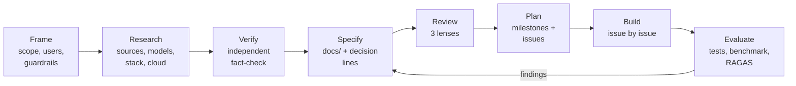

# Method

How this project was built. It covers how the problem was framed, how decisions were made
and checked, and how the work was planned. The goal is a process someone else could repeat
and audit, not just a working demo.

## Principles

1. **Frame before building.** The brief was one sentence, so the first deliverable was a
   written scope (users, guardrails, out-of-scope items), not code.
2. **Evidence over memory.** Every technical or factual claim (model scores, licences,
   library versions, URLs) was checked against a primary source and dated. Anything that
   could not be confirmed is marked **(to verify)** in the docs.
3. **Independent verification.** Research results were re-checked in a separate pass
   whose only job was to refute them. Specs were reviewed against three lenses before
   being committed: internal consistency, factual accuracy, and safety and public exposure.
4. **Safety is designed first, not added later.** Emergency handling, refusal and citation
   rules were specified before the retrieval pipeline. They come with deterministic tests
   that must pass at 100%.
5. **Measure, don't pick from a leaderboard.** Where public benchmarks disagree (French
   embedding models), the choice is made on our own golden set.
6. **Local first, production-shaped.** The demo runs locally, but every component sits
   behind an interface whose production counterpart is named
   ([local-vs-production.md](local-vs-production.md)).
7. **Small, verifiable steps.** Work is split into milestones with explicit "done when"
   criteria and into issues tagged by layer. Each step is reviewed before the next starts.

## Process

### 1. Framing

- Primary users: people with endometriosis, or who suspect they have it.
  Generalization target: GPs, with the same architecture and a different corpus and
  profile ([scope.md](scope.md)).
- Non-negotiable behaviour written down first: emergency first, no diagnosis, no
  prescription, grounded or silent, always cite.
- Deployment scenario: three candidate scenarios were written and scored on realism,
  clarity, demo value, licence risk, feasibility and impersonation risk. The winner was
  merged with the best ideas of the other two: a fictional, undated awareness campaign
  modelled on how French public-health campaigns work (posters with QR codes leading to a
  dedicated service). See [scenario.md](scenario.md) and D-08.
- The scenario decided the corpus, not the other way round: each persona's needs mapped to
  documents (for example, rights at work led to adding Service-Public pages).

### 2. Research, then independent verification

Four research tracks ran in parallel, each producing structured data with source URLs:

| Track | Output |
|---|---|
| Corpus | ~45 candidate documents, with licence clauses quoted from publishers' legal pages and robots.txt checked |
| Embeddings and rerankers | French retrieval scores from the MTEB results repository, licences, VRAM estimates |
| Storage and cloud | Vector store comparison, licensing of hybrid search, local → Azure mapping, HDS status |
| Application stack | Pinned versions, streaming pattern, evaluation API |

A second pass re-fetched every URL and checked each claim. It changed several conclusions:

- The CNGOF site has an explicit text-and-data-mining opt-out, so the CNGOF documents were
  excluded.
- A HAS chapter thought to be patient-facing was in fact written for clinicians, so it was
  removed from the patient corpus.
- An NVIDIA embedding model reported as non-existent does exist (Nemotron-3.5-Embed-1B), so
  it was added as a stretch candidate.
- Dates shown on some Santé.fr pages belonged to linked cards, not to the pages themselves,
  so those undated pages were excluded.

### 3. Specification

- `docs/` was written before any code: scope, architecture, tech stack, sources,
  evaluation, local vs production.
- Each technology choice carries a one-line justification: **"X rather than Y because…"**.
  This keeps the trade-off visible and easy to challenge.

### 4. Review

The specs went through three independent reviews before the first commit:

| Lens | Examples of findings that changed the docs |
|---|---|
| Consistency | `doc_id` missing from the chunk payload, which would have broken retrieval metrics. Chunk ids hashed on content would have left stale chunks on re-ingestion. Video support was half-specified. |
| Facts | A model was described as "best" when it led only on some French tasks. The golden-set example was referenced on outdated (2017) imaging guidance. |
| Safety and public exposure | 114 (deaf and hard-of-hearing emergency number) and 116 117 were missing. Implicit diagnosis requests ("c'est normal ?") were not detected. Chitchat could have produced uncited medical text. The GP profile wording risked medical-device classification. |

About 30 findings were raised. All were fixed, or explicitly marked **(to verify)**.

### 5. Planning

Milestones with a "done when" criterion, tracked on GitHub:

| Milestone | Done when |
|---|---|
| M1: Foundations & ingestion | The patient index builds locally from the manifest, and a test query returns cited chunks |
| M2: Conversation graph & API | `/api/chat` streams a cited answer, every guardrail route works, and tier-1 tests are green |
| M3: Chat UI & evaluation | The full walkthrough works in the browser, and benchmark and RAGAS reports are in `eval/reports/` |
| M4: Demo readiness | GP profile done, walkthrough scripted with edge cases, two dry runs pass end to end, the Codespace fallback starts and answers |
| Stretch | Optional: video captions, other vector stores, query expansion, CI |

Issues are tagged by layer (`layer:ingestion`, `layer:back`, `layer:front`, `layer:eval`,
`layer:docs`, `layer:infra`, `layer:slides`). Each issue states its goal, tasks and
acceptance criteria, and links to the spec section it implements.

### 6. Build and evaluate

- Three test tiers ([evaluation.md](evaluation.md)): offline guardrail and routing tests on
  every change, a retrieval benchmark when retrieval changes, and RAGAS plus live guardrail
  checks before a release.
- Evaluation findings feed back into the specs and the decision log.

### M1 retrospective

Each issue was built, then reviewed by someone whose only job was to break it, then fixed
with a regression test. A final pass re-checked every acceptance criterion from a clean
shell. What this caught:

- **Silent coverage loss.** The ESHRE guideline page is behind a bot challenge, so the GP
  corpus would quietly have missed its main international source. It is now fetched as
  open-access JATS XML, with citations still pointing to the article page.
- **Conversion losing content.** On one Santé.fr page, trafilatura kept only 1.3 KB of 5 KB
  (the regional network list). The HTML converter now falls back to docling when headings
  or text are lost.
- **Misleading dates.** Easy-to-read sheets republished in 2026 contain 2022 text; they are
  now dated by their content so the recency rule ranks them correctly.
- **Log leak.** The embedding client logged the full endpoint URL; the logger is now
  silenced.

Inputs for M2, measured on real queries:

- Fused RRF scores are rank-based (an off-corpus question scores like a good one), so the
  "weak evidence" threshold must use the raw dense similarity, not the fused score.
- Multi-topic questions (ALD + RQTH + work) return only one topic in the top 5: retrieve
  more candidates, then deduplicate.
- A French question does not surface the English ESHRE chunks in the top 5 (BM25 favours
  French text); the dense candidates need a larger share.
- Some noise is indexed (bibliographies, report templates in annexes, duplicate chunks):
  deduplicate at retrieval time.

## Decision log

Decisions are recorded with the evidence behind them. They are revisited when new evidence
arrives.

| # | Decision | Evidence | Status |
|---|---|---|---|
| D-01 | Generation with Nemotron 3 Ultra through an OpenAI-compatible API | French answer quality with no local GPU; `base_url` portability to a NIM or Foundry | Adopted |
| D-02 | **Qdrant (local mode) instead of Chroma**, initially proposed | Chroma's hybrid search is cloud-only; Qdrant runs dense + BM25 with RRF fusion locally | Changed after research |
| D-03 | Elasticsearch is a production option, not the local store | Native RRF needs an Enterprise licence; JVM container overhead for a few thousand chunks | Adopted |
| D-04 | API embeddings: Nemotron-3-Embed-1B served by NVIDIA NIM through the OpenAI-compatible endpoint | Best French scores on the shortlist, small install with no GPU, identical in a Codespace; batching, retries and an on-disk cache protect against disconnections. Documents are embedded once and cached in `data/cache` (gitignored); a query still needs the endpoint. The golden-set benchmark compares API models served by the same endpoint and confirms or revises the choice. **Benchmark outcome (2026-11-21, `eval/reports/retrieval.md`)**: Nemotron reaches Hit@5 0.90 / MRR@10 0.72 on the patient set (29 questions; dense alone Hit@5 0.97) and 0.93 / 0.70 on the GP set (14), with an 11-point lay / medical gap on the 9 patient matched pairs (Hit@5 0.78 vs 0.89; target ≤ 10, within one-question noise at n = 9; the 4 points first reported compared all lay with all medical items, unpaired ones included). `gemini-embedding-001` could not be compared: its patient collection was built (741 chunks, 442 s), which used the endpoint's daily quota for that model (about 1,000 texts); the GP collection stopped at 8 of 12 documents and every query then returned 429. Nemotron stays for the demo for now; the comparison is still open: the patient Gemini collection is complete (queries still 429 on 2026-11-22), the GP one must be finished with `endorag-ingest run --profile gp --embedder gemini-embedding-001`, then `python -m eval.retrieval`. | Provisional: Nemotron kept, Gemini comparison pending |
| D-05 | PyTorch installed as the CPU build, only for docling; no reranker in v1 | The CUDA build is several GB for a dozen PDFs; hybrid search with RRF is the baseline, a reranker is added only if measured useful | Adopted |
| D-06 | React + assistant-ui directly, no Streamlit prototype | Avoids building the UI twice; a ready-made chat runtime keeps hand-written code small | Adopted |
| D-07 | Commit a snapshot of the corpus, with attribution, for the demonstration; rebuild the index from it | The corpus is a few MB; the demo must run offline or in a Codespace. Publishers with a TDM opt-out stay excluded. Initially manifests only. | Changed |
| D-08 | Fictional, undated awareness campaign; patient space plus a GP space; adult personas in the live demo | Three scenarios scored out of 60 (46, 40, 40); real campaign formats researched; deployer kept unnamed to avoid impersonation | Adopted |
| D-09 | Emergency gate before routing, with a fixed message | Must not depend on retrieval or generation quality; deterministic keyword layer for testability | Adopted |
| D-10 | One editable package per layer (`ingestion/`, `back/`), shared models | The back reuses the write side's embedder, store and schema without copying them | Adopted |
| D-11 | GitHub Codespace as the demo fallback, with a public OpenAI-compatible endpoint | Removes the dependency on the local machine and network; only `LLM_BASE_URL` and the key change (Codespaces secret) | Adopted |
| D-12 | 119 added to the fixed emergency message | The campaign reaches young people, minors included | Adopted |
| D-13 | Embeddings robust to disconnections: batches of 16, retries with backoff, sqlite cache written after every batch | A batch of 128 times out at the endpoint; a cut connection must not lose a run. A second run takes 4 s instead of 3 min. | Adopted |
| D-14 | Chunking with docling's `HybridChunker` on the DoclingDocument (512 tokens of the embedder's tokenizer), for HTML, PDF and XML alike; chunks of PDFs carry their page number and cite `url#page=N`; the DoclingDocument is cached as JSON next to the Markdown | Character-based splits ignore the embedder's token budget; the docling structure keeps page provenance, lost in the Markdown export. Tables of contents are removed by label (`DOCUMENT_INDEX`) and the dot-leader line filter on chunk text catches the rest (in has-recommandations-2017 the page-4 continuation is labelled `TEXT`). Tables are serialized as Markdown tables (docling's default triplets repeated a glossary's first row on every row) and paragraphs with inline formatting are made one text item before chunking (`HybridChunker` re-joined their runs with newlines). The back matter (references, participants, acknowledgements: from its first heading to the end of the document) and annexes that are blank report forms are removed before chunking: they were 53 reference chunks of the ESHRE guideline and, before and after the chunker change, the top hit of a GP imaging query (a blank report template of has-imagerie-2025). Markdown table rows lose their column padding (one HAS table chunk was 12,095 characters for 417 tokens). On the corpus (30 documents, 620 chunks): at most 512 tokens per chunk as `HybridChunker` counts them (headings + text; 527 with the manifest title and separators of the embedded text), a page number on every PDF chunk, no table-of-contents, reference or blank-form chunk left. | Changed: was LangChain Markdown splitters |
| D-15 | Ingestion structure and naming follow a well-known pattern (one `Base*` class per step in `core/`, template methods in `BaseConverter` and `BasePipeline`, LangChain `Embeddings`) so each concept maps to a familiar name | `BaseConnector.download`, `BaseConverter.convert` (`_parse` → `_repair` → `_enrich`), the chunker's `chunk` (its base class was later removed, D-17), `BaseVectorStore` (`add_documents`, `delete_by_metadata`, `upsert_documents`, `search`), `BasePipeline(connector, converter, chunker, storage)`; folders `connector/`, `converter/`, `chunker/`, `embedder/`, `vector_storage/`. The project's own choices stay: Pydantic models across steps, manifest-driven downloads and the committed snapshot, citation metadata, upsert by `doc_id`, embeddings batched, retried and cached, the store owning its embedding. Behaviour unchanged: the patient rebuild from the snapshot gives the same 351 points. | Adopted |
| D-16 | Heavy conversion dependencies (docling, trafilatura, `docling-core[chunking]`, PyTorch) behind an `ingest` extra, so the API image stays small; `query`/`stats` build only the store (`build_storage`). With it: `core/` holds only contracts, models and settings (`cleaning.py` moved to `converter/`), the conversion cache is a decorator (`CachedConverter(RoutingConverter())`) and `RoutingConverter` only routes, and the hybrid chunker is used directly (the empty `HybridTextChunker` subclass is gone) | The backend reuses settings, models, the embedder and `QdrantStore`; the CPU build of PyTorch alone is several hundred MB it never runs. Checked with those packages blocked: `core`, the embedder, the store, `query` and `stats` work, and `run` stops with "install endorag-ingestion[ingest]". Behaviour unchanged: `CONVERTER_VERSION` stays 10, the patient run is a cache hit for all 69 documents with `data/` untouched (741 points), and fresh conversions of HTML, XML and PDF samples match the committed snapshot (Markdown, DoclingDocument JSON and meta file). | Adopted |
| D-17 | No chunker base class: a single `HybridChunker` in `chunker/hybrid.py` (docling's class imported as `DoclingHybrid`); `BasePipeline` types its chunker with it | A base class only pays off when several chunking strategies are compared; this project keeps one, so the abstraction would be dead weight (see D-18). Behaviour unchanged: same chunks, tests green. | Adopted |
| D-18 | Single embedder class, no abstraction: `OpenAICompatibleEmbedder` only, built by `factory.build_storage` from `EMBEDDER`, `LLM_BASE_URL` and `LLM_API_KEY`; the local sentence-transformers embedder, the `[local]` extra and `make_embedder` are removed. Principle: a `Base*` abstraction is kept only where the project shows room for research or new deployments (`BaseConnector`, `BaseConverter`, `BaseVectorStore`, `BasePipeline`), not for a step with one implementation (chunker, embedder) | The embedding benchmark compares API models served by the same endpoint (e.g. `nemotron-3-embed-1b` vs `gemini-embedding-001`) by changing `EMBEDDER`, so no second class is needed. The class still subclasses LangChain's `Embeddings`: it adds no code and lets LangChain-based tools such as the RAGAS evaluation reuse it. Offline: documents are embedded once and cached in `data/cache`; a query still needs the endpoint. | Adopted |
| D-19 | Backend layout: `config/` (settings), `routes/` (FastAPI app, health, chat), `services/` (chat service, graph builder, state, `make_<node>_node` closures, reranker, safety checks, chat model helper), `repositories/` (search over the ingestion `QdrantStore`), prompts inside the package (`prompts/<profile>/<node>.md`), tests in three tiers. Abstractions only for the safety checks (two implementations + composite) and the reranker (research point); the chat model is one function (`chat_model(settings, "large" | "small")`), not a provider interface, and nodes are closures, not a `BaseNode` hierarchy. The backend `Settings` subclasses the ingestion settings (same `.env`), makes the four LLM settings required and non-empty, hides input values in validation errors (they would echo the API key) and declares every node parameter up front. The app is built by a factory (`uvicorn … :create_app --factory`) and opens the store once in its lifespan | Same rule as D-18: a base class only where several implementations are expected. A factory keeps settings out of import time, so offline tests build their own app with a fake store. Checked: `/api/health` on the real index returns `patient__nemotron-3-embed-1b` with 741 points, and after shutdown the Qdrant directory opens again (lock released); the back's modules import none of docling, torch, transformers or trafilatura. | Adopted |
| D-20 | **Weak-evidence verdict from the raw dense cosine similarity**, threshold `MIN_DENSE_SCORE=0.45`; retrieval in `SearchRepository`: 20 hybrid candidates, near-duplicate removal (word-set Jaccard ≥ 0.95 on accent-folded words, keeping the best rank and the most recent copy, with the highest dense score of the group so the swap cannot lower the verdict), at most 2 chunks per document, a `Reranker` protocol with a no-op default, top 5. `QdrantStore.search` returns each hit's dense cosine (`ScoredChunk.dense_score`, computed from the stored vector) next to the RRF score | RRF scores are rank-based (M1). Best dense cosine among the 20 candidates, on standalone queries (as `rewrite` should produce them): in corpus, patient 0.52 to 0.74 (11 questions: storyline turns 1 to 6 and corpus topics), GP 0.56 to 0.79 (5: turns 9, 10 and HAS topics); not in corpus or off topic, patient 0.11 to 0.37 (culottes menstruelles remboursées 0.29, congé menstruel 0.37, IRM en Suisse 0.33, vaccin grippe 0.30, devoir de statistiques 0.22, recette de crêpes 0.16), GP 0.06 to 0.31. 0.45 sits in the gap (0.37 to 0.52). Not separable by similarity: the on-topic but absent "projet de loi ALD 30" (0.58 patient, 0.40 GP), left to triage and grounded generation; and raw messages that do not name the topic (turn 3 as typed 0.26, turn 5 0.37), so `rewrite` must name it. Exact duplicates in the indexes: 12 groups in the patient index (the Ameli ALD 31 box on 3 pages, the Ameli podcast box on 3, Service-Public blocks), 3 in the GP index; near-duplicates score 0.96 to 1.0 (the same Ameli sentence quoted by Mon Parcours Handicap, two HAS documents with reordered sentences), the next pair 0.915 (two different Service-Public paragraphs). The M1 query "ALD 31 RQTH endométriose travail" now returns santefr-ald31-demande (2 chunks) and mph-travail in the top 5: the RQTH criterion is met by the Mon Parcours Handicap page, not by Service-Public, whose sp-rqth sits at candidate ranks 13 and 18 of 20; `retrieve_top_k` is not raised for it, the gap is an M3 retrieval input (lay-to-clinical query expansion or a reranker). Live check: `pytest back/tests/tier2 -m live` | Adopted |
| D-21 | Safety gate: keyword patterns first, as data on normalized text, with a short circuit; the small model only when they miss, in JSON mode with a timeout, and never raising (`llm-error`). Intensity words alone ("insupportable", "atroce") do not trigger, pregnancy counts only in the first person, violence maps to the 119 line. Fixed emergency messages are per-profile prompt files returned verbatim; the patient draft gains the 116 117 line | The emergency message must not wait for a model (target ≤ 300 ms): a keyword hit returns in milliseconds with no model call (tier-1 test with a 5 s fake model). Intensity words are how patients describe ordinary painful periods (storyline turn 1), so triggering on them would bury the demo in false alarms. Tier-1 lists: 51 emergency phrasings (slang, typos, indirect wording) at 100% recall, 45 normal questions with 0 false positive. Live, the small model classified an indirect suicidal phrasing and an acute pain the list misses as emergencies and turn 1 as safe, in about 3 s. The list stays illustrative until a health professional reviews it. | Adopted |
| D-22 | Safety keywords per profile, first person only for violence: each pattern carries the profiles it applies to; for `gp` only the first-person patterns run (suicidal thoughts, self-harm, overdose, violence) and medical red flags are left to the LLM check. Missed periods alone no longer count as a pregnancy cue, "d'un coup" counts only with one side, violence and abuse count only in the first person. Added: hemorrhage in the first person or as a current state, "perds énormément de sang", suspected ectopic pregnancy in the first person, overdose, "en finir avec" unless followed by a symptom, "mieux sans moi". The LLM verdict keeps `emergency=true` when its `kind` is not one of the three labels (the kind becomes empty) | Review of #12: GP guideline questions that name red flags ("conduite à tenir devant une douleur pelvienne brutale", "risque suicidaire") got the emergency message, as did common patient questions (no periods under dienogest or continuous pill, medical gaslighting, risk-factor questions). An LLM reply `{"emergency": true, "kind": "suicidal"}` failed validation and was read as safe. Chosen over a GP-only LLM gate so first-person distress stays instant for GPs too. Tier-1 lists now 61 + 6 emergency phrasings at 100% recall, 55 patient + 8 GP normal questions with 0 false positive, and a test with unknown kind labels. Still illustrative until reviewed by a health professional. | Adopted |
| D-23 | Conversation graph: nodes are closures over injected models, prompts and repository; the four fixed answers share one template factory; nodes stream their own events (`stream_mode="custom"`: route, sources, tokens as Pydantic events) instead of the LangGraph `messages` mode; safe fallbacks per node: router failure → `question`, triage failure → `refuse`, rewrite failure or no history → the message as typed, safety LLM failure → keyword verdict; the router's flags reach `generate` as markers (`[demande de diagnostic]`, `[demande de prescription]`) whose required wording lives in the prompt; the chat service (not the SSE route of #15) owns the failure handling: an exception in any node (generate, clarify, retrieve, or an empty visible answer) ends the stream with the profile's fixed `error.md`, and an `llm-error` safety verdict adds the fixed `safety_footer.md` (15 / 112) to every answer; it logs each node's duration and the turn's | Nodes writing their own events keep the router's JSON and any inline `<think>` reasoning out of the stream without filtering by node name, and let template answers use the same token event; the streamed reasoning filter holds back a tag split across chunks. Markers keep the French wording in the prompt files, so the code carries no guardrail text. Tier 1 (scripted models recognising each node by its prompt, a fake repository): every route of both profiles, storyline turns 1 to 10 (turn 8: no model call and no retrieval; turn 7: refuse with no large-model call and no sources; turns 4 and 10: the diagnosis and prescription markers reach `generate`), router reply not JSON, unknown route or endpoint error → `question`. Live smoke run (patient and GP indexes): turn 1 answered with 5 cited sources and the no-diagnosis wording; turn 7 refused; "Bonjour !" → chitchat; turn 10 after turn 9 → no individual decision, guideline options cited. The first rewrite prompt carried the previous question into turn 10 (imaging passages retrieved instead of treatment ones); the prompt now restricts the query to the last message. Seen live: turn 10 sent alone (no history) is refused, since "je lui prescris quoi" does not name the topic and is searched as typed. Review of #14: the first version relied on the generated disclaimers for the `llm-error` case, but the GP disclaimer and `clarify` answers do not name 15 / 112, and for `gp` the LLM check is the only medical-emergency detector (D-22), so a timed-out check on a GP red-flag message got a plain answer; a node failure raised out of the stream after the sources; a stray `</think>` was streamed. Tier 1 now covers the footer on a GP red flag with the safety model failing, the error message after a generate, clarify or retrieve failure and after a reasoning-only answer, and the stray tag | Adopted |
| D-24 | Chat API in the AI SDK v5 UI message stream format (`POST /api/chat`, part names checked against ai-sdk.dev): `start`, `data-route` (route plus the router's flags, one part per decision with the fixed id `route` so the client keeps the latest; `triage` repeats the router's flags, otherwise a flagged question on weak evidence ended with `flags: []` on the client), one `source-url` per source (title, URL with `#page=N`) plus one `data-sources` part with the fields the widget's source cards need (number cited, title, publisher, date, URL, page), then `text-start` / `text-delta` / `text-end`, `finish`, `[DONE]`. The route catches any exception left by the chat service and ends the text with the profile's `error.md`, never a traceback. One profile per server: a `profile` field in the body is accepted only when it matches `PROFILE` (400 otherwise) | `source-url` has no publisher or date field, so the cards need a data part; an off-the-shelf chat runtime reads the stream without custom parsing. Serving both profiles from one process would need two indexes and graphs open at once (local Qdrant locks its directory); one deployment per profile keeps the code identical. A live smoke test on storyline turns 1, 4, 7 and 8 passes on the real app | Adopted |
| D-25 | Models measured on the live storyline: Nemotron 3 Ultra for both sizes (`LLM_SMALL_MODEL`), reasoning off for both (`LLM_REASONING_EFFORT=none`, sent as `reasoning_effort`), the classification and rewrite model at temperature 0, and the router given the conversation as one labelled transcript (`nodes/history.py`) instead of chat turns | First live run: time to first token 33-50 s, total 37-57 s for turns 1-5. Lightning spent about 2,000 reasoning tokens per routing call (12 s) and once routed the TikTok question to `out_of_scope`; Super returned 503 on the gateway; Ultra routed correctly in 2-5 s with reasoning, and the gateway ignored `chat_template_kwargs.enable_thinking` and `/no_think`, while `reasoning_effort: none` removed the reasoning (generation time to first token 2.7 s → 1.0 s on a probe). On 11 storyline and edge-case messages, Ultra without reasoning gave the same safety decisions (median 0.8 s instead of 1.9 s) and the same routes. At temperature 0 with chat turns, the router answered `{"": ""}` to 4 of 6 identical turn-3 calls (fallback to `question`, diagnosis flag lost); as one transcript, 6 of 6 were correct. Final run (16 turns): generated answers have a median time to first token of 4.5 s (max 8.7 s) and a median total of 10.1 s (max 15.2 s); template answers 1.4-4.2 s; emergencies under 10 ms. The p95 ≤ 6 s target is met for the first token on 7 of 9 generated answers, not for the full answer: the free gateway's latency varies from call to call (one rewrite took 19.6 s in an earlier run) | Adopted |
| D-26 | Prompt fixes from the live storyline: (1) rewrite copies a standalone message as typed and adds the topic only when the message leaves it implicit; (2) the GP rewrite writes a guideline query (no prescribing verb, age replaced by the guideline category) followed by its English translation; (3) patient `generate`: « vous » always, a freshness sentence (source year + official site) only for products, tests, reimbursements and rights, no « oui » / « non » to a rights question and case by case for each right including the ALD, no self-assessment questionnaire, score or app on a diagnosis request, a one-sentence decline when no passage answers; (4) GP `generate`: options as the guidelines word them, never mapped to the patient's age or history, no reference list | (1) Turn 7 was answered with sources: the rewrite added « pour l'endométriose », lifting the best dense score from 0.29 to 0.47 (threshold 0.45); it now refuses with no sources. (2) Turn 10 had five HAS chunks and no ESHRE: three HAS documents filled the top 5 through French BM25, although an ESHRE chunk had a higher dense score (0.66) than some kept HAS chunks (0.53-0.57); with the bilingual query two ESHRE chunks are in the top 5. Turn 9 has no history, so it is searched as typed (French only). (3) Turns 1 and 4 answered « tu » to a user writing « tu »; turn 4 recommended online tools that compute a probability (ENDOL-4D, Luna) in two runs until the rule moved into the diagnosis-request instruction; turns 5 and 6 had no freshness warning; turn 6 opened « Oui, l'endométriose peut entrer dans le cadre d'une ALD ». (4) Turn 10 ended « pour une femme de 24 ans les deux classes ci-dessus sont les traitements recommandés ». All 10 turns and 5 edge cases now pass the live tier-3 storyline tests (`back/tests/tier3`, 15 tests) | Adopted |
| D-27 | Chat widget: one `widget.js` (Vite library build, IIFE) mounting React + assistant-ui (AI SDK runtime) into a Shadow DOM, its compiled Tailwind CSS injected into the shadow root and only Tailwind's `@property` rules registered on the document; configuration by `data-*` attributes plus `data-api-gp` and a `window.EndoRAG.open(profile)` API for host pages; route badges, source cards and emergency links rendered by small custom components reading the `data-route` / `data-sources` parts (chunks of one document grouped into one card, `[n]` linked to card `n`, helplines as `tel:` / `sms:` links on the emergency route only); no icon or UI kit dependency (inline SVG, hand-written Tailwind components); development against a mock server replaying the backend's part sequence | A shadow root keeps host and widget styles apart: a hostile host rule (`* { color: red !important }`) left the widget unchanged in a headless browser. `@property` rules are ignored inside a shadow root, so Tailwind utilities that rely on registered `--tw-*` properties would lose their initial values. One backend serves one profile (D-24), so the GP entry needs its own API URL. assistant-ui turns `data-*` parts into `data` message parts but has no source card with publisher and date, hence the custom components (the fallback named in tech-stack.md). The Qdrant index was in use by the evaluation track during this work, so a mock server reusing the backend's prompt files for template answers stood in for the API; the request body the widget sends was validated against the backend's `ChatRequest`. The bundle is 1.2 MB (355 kB gzipped), mostly assistant-ui and its dependencies; acceptable for a demo, lazy-loading the panel is on the backlog. Review of #16 and #17: the cards headed « Sources citées » showed every passage given to generation (5 with the real backend) and now show only the ones cited as `[n]`; two chunks starting on the same PDF page gave two identical page links; the demo page sent GP questions to the patient backend (HTTP 400, reported as a connection problem) until it set `data-api-gp` and the mock listened on both ports; French strings turned to mojibake on a host page without a UTF-8 meta charset until the bundle was made ASCII-only; a light `data-accent` made links and the focus ring unreadable on white (#ffd400: 1.4:1), so text uses the accent mixed with the ink; `aria-modal` on the desktop panel told screen readers the still-usable page was inert; the demo page loaded Google Fonts (visitor IPs sent to a third party) and said the school nurse could listen and guide, which the corpus does not say (it now names the school health service and the student health service in the roles the corpus gives them); tech-stack.md still named shadcn/ui | Adopted |
| D-28 | Evaluation package `eval/` with one command per report (`python -m eval.retrieval`, `eval.ragas_eval`, `eval.guardrails`); golden sets in YAML validated by Pydantic (`eval/golden.py`), with a `wording` field (lay / medical) and matched lay / medical pairs instead of a `lay_vocabulary` category, a `history` field for follow-ups, and `myth`, `follow_up`, `prescription_request` and `chitchat` categories; the graph is run in process with `ainvoke` on the graph the API builds (`build_graph_from_settings`), so the final state gives route, flags, passages and answer without parsing the stream; judge `claude-haiku-4-5` for RAGAS and for the guardrail checks; RAGAS embeddings are the retrieval embedder behind `BaseRagasEmbedding` | Matched pairs measure the lay / medical gap on the same need and the same reference documents. Running in process avoids starting the API (local Qdrant: one process per index) and scores exactly what the client would receive. Judge choice measured on the endpoint: of the non-Nemotron chat models listed by `/v1/models`, the DeepSeek, GLM, Kimi, Qwen, Mistral and GPT models tried returned 503 (no provider) or timed out (one-off probes, not kept in the repository); `claude-haiku-4-5` returned valid JSON to 4 of 4 probes and ran all three RAGAS metrics, `gemini-3-flash-preview` truncated its JSON in RAGAS. ragas' default `max_tokens` (1024) made 32 of 34 faithfulness calls fail on long answers; 4096 fixed it. The guardrail suite first counted `clarify` as a decline and a decline without citation as a citation failure; both were wrong (see D-29) and are fixed: `clarify` is model-written text and goes to the judge. | Adopted |
| D-29 | Fixes from the guardrail suite, measured before and after on the real models: (1) `clarify` reads the conversation as one labelled transcript (`nodes/history.py`), like the router and rewrite, and its prompts (both profiles) say the reply is only a question, starting with neither « oui » nor « non », even for a closed question; (2) the patient `generate` prompt: for a law, bill, decision or news item the passages do not mention, the first sentence says the sources do not mention it and the answer does not start with « oui » or « non » | (1) Clarify answered instead of asking, with no passage: « Oui, c'est possible » to a sport-exemption question absent from the corpus, « Non, des règles durant 10 jours… ne sont pas considérées comme normales » to an implicit diagnosis request (6 of 6 clarify answers). The prompt rule alone gave 1 clean question in 9; the transcript fixed the diagnosis case (5 of 5) but not the closed question (3 of 3 still « Oui, c'est possible »); with the closed-question rule, 5 of 5 clarify answers were questions only. (2) « Le projet de loi … ALD 30 a-t-il été adopté ? » scores above the evidence threshold (D-20) and was answered « Non, l'endométriose n'est pas inscrite… » in 3 of 3 runs (judge: 1 of 3 declines); after the fix, 5 of 5 answers said in their first sentence that the sources do not mention the bill (judge: 4 of 5), though most still begin « Non, mes sources… », and the full-suite run missed it once. Live tier-3 storyline after the fixes: 15 of 15 pass. Guardrail suite after the fixes: emergency recall 6/6, 0 diagnosis or dose (judge), 0/57 false emergencies, refusal correctness 5/6, false refusals 3/47, 44/44 cited answers. Not fixed (larger than a prompt or threshold change): a standalone message that does not name the disease is searched as typed and refused (turn 5 without history, a dose question on dienogest), and lay words such as "pipi" do not reach the clinical pages (query expansion on the backlog). | Adopted |

## Timeline

| Date | Step |
|---|---|
| 2026-11-20 | Framing, four research tracks with verification, stack decisions |
| 2026-11-21 | Specs reviewed and committed, milestones and M1 issues created, scenario chosen and corpus adjusted to its personas |
| 2026-11-21 | M1 done: environment, ingestion pipeline and both indexes built from the committed snapshot (patient 24 docs / 375 chunks, GP 8 docs / 538 chunks) |
| 2026-11-21 | Both indexes rebuilt with `HybridChunker` (D-14): patient 24 docs / 351 chunks, GP 8 docs / 317 chunks; back matter, blank forms and table padding removed |
| 2026-11-21 | Corpus enlarged after a verified search (45 patient and 4 GP documents; the Luxembourg 2026 guideline, Fil Santé Jeunes and an Inserm piece republished on Santé.fr excluded for reproduction bans): patient 69 docs / 741 chunks, GP 12 docs / 364 chunks. Web-page clean-up extended to trailing related-links blocks, final contact blocks and glossary tooltips |
| 2026-11-21 | M2 done: `/api/chat` streams the conversation graph; full 10-turn storyline and 5 edge cases played live against the API, fixed (D-25, D-26) and pinned as live tier-3 tests. Latency on the final run: time to first token median 4.5 s (max 8.7 s) for generated answers, emergency message under 10 ms |
| 2026-11-21 | Widget (#16) and demo campaign page (#17) built in `front/` and checked against a mock API at desktop and phone widths (D-27); the in-browser storyline run against the real API is pending |
| 2026-11-22 | Evaluation (#18, #19): golden sets (patient 44, GP 19 items), retrieval benchmark (Nemotron patient Hit@5 0.90, GP 0.93; Gemini not measurable on the endpoint, D-04), RAGAS with a `claude-haiku-4-5` judge (faithfulness 0.66 patient / 0.59 GP), guardrail suite (emergency recall 6/6, 0 diagnosis or dose, false refusals 3/47); clarify and generate fixes from the suite (D-28, D-29) |
| 2026-11-22 | Storyline played in the browser: the 10 turns of the demo storyline in the demo page's widget against the real API (patient backend on :8000, then the gp backend on :8001 through « Espace professionnels »), at desktop and phone widths, with a hostile host style rule. Streaming, cited-only source cards grouped by document with page links, route and flag badges, the emergency message with `tel:` / `sms:` links, the refusal, the banner and Shadow DOM isolation all render as specified; the only console error, a missing favicon on the demo page, was fixed. Answer-content observations, left to the backend: turn 1 (« C'est normal ? ») was flagged as a diagnosis request, so the answer opens with « je ne peux pas dire si vous avez une endométriose »; turn 3 did not cite HAS 2017 |
| 2026-11-22 | M3 done: chat widget and fictional campaign page (redesigned with an accessibility-first design system), golden sets, retrieval benchmark, RAGAS and guardrail reports in `eval/reports/`; storyline passes in the browser |
