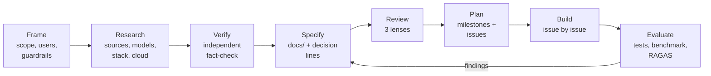

# Method

How this project was built. It covers how the problem was framed, how decisions were made
and checked, and how the work was planned. The goal is a process someone else could repeat
and audit, not just a working demo.

## Principles

1. **Frame before building.** The brief was one sentence, so the first deliverable was a
   written scope (users, guardrails, out-of-scope items), not code.
2. **Evidence over memory.** Every technical or factual claim (model scores, licences,
   library versions, URLs) was checked against a primary source and dated. Anything that
   could not be confirmed is marked **(to verify)** in the docs.
3. **Independent verification.** Research results were re-checked in a separate pass
   whose only job was to refute them. Specs were reviewed against three lenses before
   being committed: internal consistency, factual accuracy, and safety and public exposure.
4. **Safety is designed first, not added later.** Emergency handling, refusal and citation
   rules were specified before the retrieval pipeline. They come with deterministic tests
   that must pass at 100%.
5. **Measure, don't pick from a leaderboard.** Where public benchmarks disagree (French
   embedding models), the choice is made on our own golden set.
6. **Local first, production-shaped.** The demo runs locally, but every component sits
   behind an interface whose production counterpart is named
   ([local-vs-production.md](local-vs-production.md)).
7. **Small, verifiable steps.** Work is split into milestones with explicit "done when"
   criteria and into issues tagged by layer. Each step is reviewed before the next starts.

## Process

### 1. Framing

- Primary users: people with endometriosis, or who suspect they have it.
  Generalization target: GPs, with the same architecture and a different corpus and
  profile ([scope.md](scope.md)).
- Non-negotiable behaviour written down first: emergency first, no diagnosis, no
  prescription, grounded or silent, always cite.
- Deployment scenario: three candidate scenarios were written and scored on realism,
  clarity, demo value, licence risk, feasibility and impersonation risk. The winner was
  merged with the best ideas of the other two: a fictional, undated awareness campaign
  modelled on how French public-health campaigns work (posters with QR codes leading to a
  dedicated service). See [scenario.md](scenario.md) and D-08.
- The scenario decided the corpus, not the other way round: each persona's needs mapped to
  documents (for example, rights at work led to adding Service-Public pages).

### 2. Research, then independent verification

Four research tracks ran in parallel, each producing structured data with source URLs:

| Track | Output |
|---|---|
| Corpus | ~45 candidate documents, with licence clauses quoted from publishers' legal pages and robots.txt checked |
| Embeddings and rerankers | French retrieval scores from the MTEB results repository, licences, VRAM estimates |
| Storage and cloud | Vector store comparison, licensing of hybrid search, local → Azure mapping, HDS status |
| Application stack | Pinned versions, streaming pattern, evaluation API |

A second pass re-fetched every URL and checked each claim. It changed several conclusions:

- The CNGOF site has an explicit text-and-data-mining opt-out, so the CNGOF documents were
  excluded.
- A HAS chapter thought to be patient-facing was in fact written for clinicians, so it was
  removed from the patient corpus.
- An NVIDIA embedding model reported as non-existent does exist (Nemotron-3.5-Embed-1B), so
  it was added as a stretch candidate.
- Dates shown on some Santé.fr pages belonged to linked cards, not to the pages themselves,
  so those undated pages were excluded.

### 3. Specification

- `docs/` was written before any code: scope, architecture, tech stack, sources,
  evaluation, local vs production.
- Each technology choice carries a one-line justification: **"X rather than Y because…"**.
  This keeps the trade-off visible and easy to challenge.

### 4. Review

The specs went through three independent reviews before the first commit:

| Lens | Examples of findings that changed the docs |
|---|---|
| Consistency | `doc_id` missing from the chunk payload, which would have broken retrieval metrics. Chunk ids hashed on content would have left stale chunks on re-ingestion. Video support was half-specified. |
| Facts | A model was described as "best" when it led only on some French tasks. The golden-set example was referenced on outdated (2017) imaging guidance. |
| Safety and public exposure | 114 (deaf and hard-of-hearing emergency number) and 116 117 were missing. Implicit diagnosis requests ("c'est normal ?") were not detected. Chitchat could have produced uncited medical text. The GP profile wording risked medical-device classification. |

About 30 findings were raised. All were fixed, or explicitly marked **(to verify)**.

### 5. Planning

Milestones with a "done when" criterion, tracked on GitHub:

| Milestone | Done when |
|---|---|
| M1: Foundations & ingestion | The patient index builds locally from the manifest, and a test query returns cited chunks |
| M2: Conversation graph & API | `/api/chat` streams a cited answer, every guardrail route works, and tier-1 tests are green |
| M3: Chat UI & evaluation | The full walkthrough works in the browser, and benchmark and RAGAS reports are in `eval/reports/` |
| M4: Demo readiness | GP profile done, walkthrough scripted with edge cases, two dry runs pass end to end, the Codespace fallback starts and answers |
| Stretch | Optional: video captions, other vector stores, query expansion, CI |

Issues are tagged by layer (`layer:ingestion`, `layer:back`, `layer:front`, `layer:eval`,
`layer:docs`, `layer:infra`, `layer:slides`). Each issue states its goal, tasks and
acceptance criteria, and links to the spec section it implements.

### 6. Build and evaluate

- Three test tiers ([evaluation.md](evaluation.md)): offline guardrail and routing tests on
  every change, a retrieval benchmark when retrieval changes, and RAGAS plus live guardrail
  checks before a release.
- Evaluation findings feed back into the specs and the decision log.

### M1 retrospective

Each issue was built, then reviewed by someone whose only job was to break it, then fixed
with a regression test. A final pass re-checked every acceptance criterion from a clean
shell. What this caught:

- **Silent coverage loss.** The ESHRE guideline page is behind a bot challenge, so the GP
  corpus would quietly have missed its main international source. It is now fetched as
  open-access JATS XML, with citations still pointing to the article page.
- **Conversion losing content.** On one Santé.fr page, trafilatura kept only 1.3 KB of 5 KB
  (the regional network list). The HTML converter now falls back to docling when headings
  or text are lost.
- **Misleading dates.** Easy-to-read sheets republished in 2026 contain 2022 text; they are
  now dated by their content so the recency rule ranks them correctly.
- **Log leak.** The embedding client logged the full endpoint URL; the logger is now
  silenced.

Inputs for M2, measured on real queries:

- Fused RRF scores are rank-based (an off-corpus question scores like a good one), so the
  "weak evidence" threshold must use the raw dense similarity, not the fused score.
- Multi-topic questions (ALD + RQTH + work) return only one topic in the top 5: retrieve
  more candidates, then deduplicate.
- A French question does not surface the English ESHRE chunks in the top 5 (BM25 favours
  French text); the dense candidates need a larger share.
- Some noise is indexed (bibliographies, report templates in annexes, duplicate chunks):
  deduplicate at retrieval time.

## Decision log

Decisions are recorded with the evidence behind them. They are revisited when new evidence
arrives.

| # | Decision | Evidence | Status |
|---|---|---|---|
| D-01 | Generation with Nemotron 3 Ultra through an OpenAI-compatible API | French answer quality with no local GPU; `base_url` portability to a NIM or Foundry | Adopted |
| D-02 | **Qdrant (local mode) instead of Chroma**, initially proposed | Chroma's hybrid search is cloud-only; Qdrant runs dense + BM25 with RRF fusion locally | Changed after research |
| D-03 | Elasticsearch is a production option, not the local store | Native RRF needs an Enterprise licence; JVM container overhead for a few thousand chunks | Adopted |
| D-04 | API embeddings by default: Nemotron-3-Embed-1B served by NVIDIA NIM; the same weights locally as the offline fallback | Best French scores on the shortlist, small install with no GPU, identical in a Codespace; batching, retries and an on-disk cache protect against disconnections. The golden-set benchmark confirms or revises the choice. | Changed: was local GPU models |
| D-05 | PyTorch installed as the CPU build, only for docling; no reranker in v1 | The CUDA build is several GB for a dozen PDFs; hybrid search with RRF is the baseline, a reranker is added only if measured useful | Adopted |
| D-06 | React + assistant-ui directly, no Streamlit prototype | Avoids building the UI twice; a ready-made chat runtime keeps hand-written code small | Adopted |
| D-07 | Commit a snapshot of the corpus, with attribution, for the demonstration; rebuild the index from it | The corpus is a few MB; the demo must run offline or in a Codespace. Publishers with a TDM opt-out stay excluded. Initially manifests only. | Changed |
| D-08 | Fictional, undated awareness campaign; patient space plus a GP space; adult personas in the live demo | Three scenarios scored out of 60 (46, 40, 40); real campaign formats researched; deployer kept unnamed to avoid impersonation | Adopted |
| D-09 | Emergency gate before routing, with a fixed message | Must not depend on retrieval or generation quality; deterministic keyword layer for testability | Adopted |
| D-10 | One editable package per layer (`ingestion/`, `back/`), shared models | The back reuses the write side's embedder, store and schema without copying them | Adopted |
| D-11 | GitHub Codespace as the demo fallback, with a public OpenAI-compatible endpoint | Removes the dependency on the local machine and network; only `LLM_BASE_URL` and the key change (Codespaces secret) | Adopted |
| D-12 | 119 added to the fixed emergency message | The campaign reaches young people, minors included | Adopted |
| D-13 | Embeddings robust to disconnections: batches of 16, retries with backoff, sqlite cache written after every batch | A batch of 128 times out at the endpoint; a cut connection must not lose a run. A second run takes 4 s instead of 3 min. | Adopted |

## Timeline

| Date | Step |
|---|---|
| 2026-11-20 | Framing, four research tracks with verification, stack decisions |
| 2026-11-21 | Specs reviewed and committed, milestones and M1 issues created, scenario chosen and corpus adjusted to its personas |
| 2026-11-21 | M1 done: environment, ingestion pipeline and both indexes built from the committed snapshot (patient 24 docs / 375 chunks, GP 8 docs / 538 chunks) |
